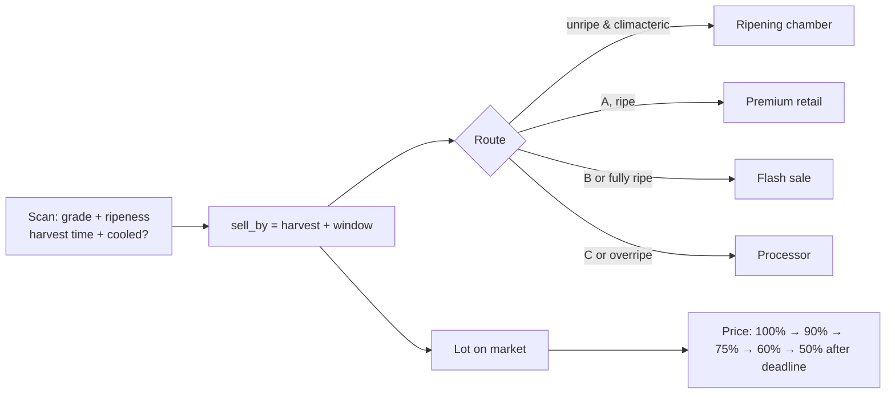

# ChillChain architecture

How ChillChain is built, how data and (test) money move through it, and which checks happen where. For an overview, see the [README](../README.md); for setup, [SETUP.md](SETUP.md).

## 1. Overview

ChillChain is a single **TanStack Start** app (React 19 with server functions) that can run on Cloudflare or Node. Login is **Clerk**, data is **Neon Postgres**. It started as a copy of FreshGrid and keeps its engine; the users and the produce changed (see [CHANGES-FROM-FRESHGRID.md](CHANGES-FROM-FRESHGRID.md)).

| Concern                         | Where it runs                                        | Code                                                       |
| ------------------------------- | ---------------------------------------------------- | ---------------------------------------------------------- |
| UI, routing, language, theme    | Browser                                              | `src/routes/*`, `src/components/fg/*`, `src/lib/store.tsx` |
| Every database action           | Server functions → Neon                              | `src/lib/app.functions.ts`, `src/lib/account.functions.ts` |
| Who is calling                  | Clerk session on the server                          | `src/lib/session.server.ts` (`requireUserId`)              |
| Prices, slots, fares, totals    | Postgres functions                                   | `neon/*.sql`                                               |
| Produce grading (AI)            | Browser, TensorFlow.js (lazy-loaded)                 | `src/components/fg/ScanTab.tsx`                            |
| Sell-by clock, channels, decay  | Server sets sell-by; Postgres fixes order price      | `src/lib/shelf.ts`, `lot_price_factor()` in `neon/009`     |
| ProfitPlanter (crop advisor)    | Browser (pure functions)                             | `src/lib/advisor.ts`                                       |
| ChillScore ratings              | Server scores a rating; browser shows                | `src/lib/krishisaakh.ts`, `submitRating` in app.functions  |
| Market prices                   | Server function → data.gov.in                        | `src/lib/mandi.functions.ts`                               |
| Assistants (Chill / Safar)      | `/api/chat` → Gemini                                 | `src/routes/api/chat.ts`, `src/lib/ai.server.ts`           |
| Emails                          | Server → Resend, respecting Settings                 | `src/lib/email.server.ts`, `emailFor()`                    |
| Live updates                    | Polling (React Query), paused when the tab is hidden | `src/lib/data.ts`                                          |

**Design principle:** the browser is not trusted with anything involving money, time or identity. The caller's id comes from Clerk on the server. The sell-by time of a scan is calculated on the server from crop, grade, ripeness, harvest time and cold chain; a lot listed from a scan copies it in Postgres; and the price a buyer pays is fixed by `place_order()` from that clock.

## 2. App flow

```mermaid
flowchart TD
  A[Open app] --> W[Who are you?<br/>Grower/FPO · Reefer/transporter · Buyer · Storage owner]
  W --> B[Log in / create account (Clerk)]
  B --> D{Profile complete?}
  D -- no --> E[Profile + privacy consent<br/>buyers pick a buyer type]
  D -- yes --> F{Role}
  F -- grower --> G[Home · Plan · Cool/Move · Sell · Help]
  F -- transporter --> T[Trips · Pay · Income · Vehicle · Help]
  F -- buyer --> H[Market · Pre-orders · My orders]
  F -- owner --> O[Live · Bookings · My facility]
```

## 3. The sell-by clock



- **Window** = crop shelf life (open air or cold chain) × grade factor (A 1, B 0.7, C 0.4) × ripeness factor (1.6, 1.3, 1, 0.6, 0.25), at least 2 hours.
- **Price factor** by share of the window left: ≥50% → 1, ≥25% → 0.9, ≥10% → 0.75, else 0.6; past sell-by → 0.5 (processor channel) and orders close 24 h later.
- **Channel**: C-grade or expired → processor; B-grade or factor < 1 → flash sale; otherwise premium retail.

## 4. Main data

| Table                                                              | Holds                                                                                             |
| ------------------------------------------------------------------ | ------------------------------------------------------------------------------------------------- |
| `profiles`, `user_roles`                                           | Person, role, buyer type, crop-advisor farm (`farm`), settings, consent                           |
| `cold_rooms`, `bookings`                                           | Facilities (cold room / pre-cool / ripening, day and hour rates), bookings with `hours`, `ends_at` |
| `scans`                                                            | Grade certificate plus ripeness, harvest time, `sell_by`, cold chain and suggested route          |
| `lots`, `lot_handover`                                             | Lots for sale (`base_price`, `sell_by`, `scan_id`, `preorder_id`), secret escrow codes            |
| `preorders`                                                        | Buyer demand before harvest; accepted ones become escrow lots                                     |
| `districts`, `vehicle_types`, `transporters`, `transport_bookings` | Truck network, drivers, trips, shared pools (`pool_code`) and `deliver_by` deadlines              |
| `ks_ratings`, `ks_disputes`                                        | Ratings and disputes                                                                              |

## 5. Escrow, pre-orders and trips

- **Lots:** open → escrow (buyer orders at the clock price) → settled (buyer types the grower's 6-digit code; 5 wrong tries lock it).
- **Pre-orders:** open → matched (a grower accepts; a lot is created straight into the buyer's escrow at the agreed price) or cancelled.
- **Shared trucks:** a shared booking joins an open pool with the same route, day, vehicle and reefer setting if the load fits; each grower pays their share of the fare plus 15% (minimum ₹150). A driver accepting one booking takes the whole pool.
- **Trips:** requested → assigned → in transit → delivered → fare received. Delivery after `deliver_by` lowers the driver's "Delivered before the deadline" score.

## 6. ChillScore ratings

ChillScore is the app name for the rating engine in `src/lib/krishisaakh.ts` (the code keeps its original name).


Each finished deal can be rated once per side. The server computes the record-based parts (gate-pass timestamps, release dates, trip timestamps and deadline, settlement time, hand-backs) and combines them with the rater's answers using each flow's weights. Ratings stay hidden for 48 hours, or until both sides rate. Reputation = recency average `R = 0.25·S + 0.75·R_prev`, stars `1 + 4·R/100`, smoothed toward 5★ with 5 virtual deals. Upheld disputes are excluded.

## 7. Known gaps

- Payment confirmation is simulated in the browser. Before real use it must come from a payment-gateway webhook.
- Ripeness is estimated (or picked by the grower); only apple and cherry tomato have trained grading models.
- Shelf-life hours, advisor costs and subsidy shares are indicative and should be checked with horticulture experts.
- Many exotic crops have no Agmarknet series, so they show indicative farm-gate prices.
