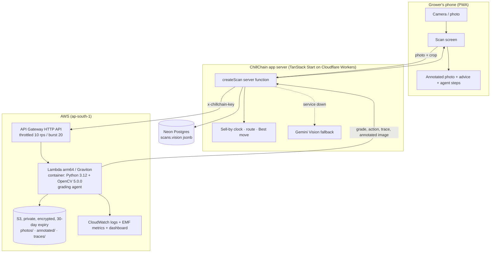

# ChillChain: technical report

OpenCV AI Competition 2026, powered by AWS · Team Rocket (Rahul Rajpal, Anmol, Parth, Anirudh)
Paths: **Agentic Vision with OpenCV 5** (not the COOL path; see Limitations)

## 1. Problem

Short-shelf-life, high-value produce (strawberries, litchi, dragon fruit, cherries, figs, cut
flowers, mushrooms) is sold on **grade**, and it spoils in **days or hours**. In India most of it is
grown by small farmers and FPOs who have no grading line: a grade is a buyer's glance at the gate,
often after the lot has sat in the heat. A lot with two mouldy berries in a crate of thirty is
marked down as a whole, or rejected on delivery, although the grower could have pulled those two
berries out in the field and sold the rest as premium.

ChillChain is a phone app that gives each lot a **sell-by clock** and tells the grower what to do in
the next few hours: pre-cool, sell, take a buyer's pre-order, share a reefer, ripen, or send to a
processor. All of that depends on one input being right: **the grade and ripeness of the lot from a
phone photo.** This entry makes that input an OpenCV 5 vision system that runs on AWS and acts on
what it sees.

## 2. Users

- **Growers and FPO staff** photographing lots at harvest, on a mid-range Android phone, outdoors,
  often in harsh sun or poor light, in one of 15 Indian languages.
- **Buyers** (quick-commerce, premium retail, hotels, exporters, processors) who see the grade, who
  made it (OpenCV, Gemini fallback, or the grower), and the evidence.

## 3. What the vision system does

For one photo and the crop the grower picked, the agent returns a lot grade (A premium/export,
B local retail, C processing), a ripeness stage (1 unripe to 5 overripe), uniformity, per-piece
grades, defect phrases, an annotated image and **one next action**:

| Action                                                 | When                                           | What the app does                                                                           |
| ------------------------------------------------------ | ---------------------------------------------- | ------------------------------------------------------------------------------------------- |
| `retake` (blur / dark / glare / no_produce / not_crop) | the photo can't support a grade                | shows the exact fix; nothing is saved                                                       |
| `confirm`                                              | confidence < 0.6                               | opens self-grading with the agent's suggestion; the grower decides (human in the loop)      |
| `sort_and_rescan`                                      | a few pieces (≤ 30%) drag the lot's grade down | outlines them thick; the grower pulls them for a processor and rescans for the better grade |
| `accept` (± `flagged`)                                 | confident grade                                | saves it; the sell-by clock, route and "Best move now" are computed from it                 |

The vision result therefore changes **what the system does next** at three levels: which OpenCV
tool the agent calls next (enhance or not, which segmenter), whether a human is asked for a photo
or an approval, and the grower's physical action and the lot's whole downstream plan (price
channel, clock length, route).

## 4. Architecture

The API key lives only in server secrets (verified: it does not appear in the browser bundle).
The browser cannot change a grade: grading and the sell-by clock are computed on the server.

## 5. OpenCV 5 implementation

All image work is OpenCV 5.0.0 (`opencv-python-headless==5.0.0.93`), in `vision/chillvision/tools.py`.

1. **Capture check.** 99th percentile of |Laplacian| for focus; mean V for exposure; share of
   blown-out, colourless pixels for glare; colour cast measured **only on near-grey pixels** (tarp,
   crate, table), because a frame full of red berries is red, not tinted.
2. **Enhancement** (when dim or tinted): white balance from neutral pixels and CLAHE on LAB lightness.
3. **Segmentation, three methods the agent switches between:** (a) background subtraction against
   the median LAB colour of the image border with Otsu thresholding, refused when the border itself
   is the crop's colour; (b) a crop-colour prior in HSV for full-crate shots with no background;
   (c) GrabCut seeded from the best previous mask. Holes are filled only when they are small or
   bright enough to be seeds, highlights or bruises; dark gaps between fruit are kept open.
4. **Piece splitting.** Distance transform; peaks found by dilation become seeds; watershed on the
   distance relief (not on colour, because touching berries share a colour).
5. **Per-piece analysis** on an eroded mask (rims cast shadows):
   - bruises and dark spots: morphological **black-hat** on LAB lightness after clipping highlights
     and seeds to the skin's median, so only depressions below normal skin count;
   - browning and rot: brown hues clearly darker than the piece's own skin;
   - mould: pale, low-saturation patches with high local texture (7×7 standard deviation);
   - colour shares: ripe, unripe and expected hues from a per-crop profile (`profiles.py`).
6. **Grading.** A piece is C at ≥ 10% defective skin or ≥ 2% mould, B at ≥ 2.5% or when a crop that
   must be fully coloured (strawberry, litchi, cherry) isn't; the lot takes the grade of its worst
   10% of pieces, as buyers grade.
7. **Confidence** combines focus, segmentation method, colour match to the crop, how close the
   deciding piece is to a threshold, and whether one piece is standing in for a whole lot.
8. **Annotation.** Each piece outlined in its grade's colour, defects tinted red, pieces to pull out
   drawn thick.

## 6. AWS deployment

Defined in `vision/template.yaml` (AWS SAM), deployed with `sam build && sam deploy --guided`:

- **Lambda, arm64 (Graviton), container image**, 2 GB memory, 25 s timeout. OpenCV 5 and NumPy
  are pinned and both ship aarch64 wheels.
- **API Gateway HTTP API** with route throttling (10 requests/s, burst 20) to cap cost and abuse,
  plus a shared-secret header checked with a constant-time compare.
- **S3**: private (all public access blocked), SSE-S3 encrypted, objects expire after 30 days.
  Each scan stores the original photo, the annotated image and the full agent trace, which gives an
  audit trail for disputed grades between grower and buyer.
- **CloudWatch**: 14-day log retention; one Embedded Metric Format line per request publishes
  latency, scans by action and scans by grade with no extra API calls; a dashboard is created
  with the stack.
- **Least privilege**: the function's only permission beyond logs is CRUD on its own bucket.
- **Cost**: a grade took about 0.2–0.6 s of compute for an 800 px image in our tests. At 2 GB that
  is about 0.4–1.2 GB-seconds per scan, which at Lambda's published arm64 price is a few US cents per
  thousand scans, plus API Gateway and S3. [TEAM: replace with the p50/p95 from your CloudWatch
  dashboard after deploying.]

## 7. Evaluation

**Behaviour tests (synthetic scenes, `vision/tests`, 14 passing).** Clean lots grade A; 2 bruised
berries in 12 → lot C with `sort_and_rescan` → A if sorted; one mouldy berry is caught; half-damaged
lots stay C without a sorting suggestion; unripe berries grade B at ripeness 1; blurry, dark,
no-produce and wrong-colour photos get the matching retake; a dim photo is enhanced then graded; a
full crate with no visible background makes the agent switch from background subtraction to the
colour prior and still separates all 20 berries; the Lambda handler rejects a wrong key. The app's
TypeScript client was tested against the running service end to end. These tests check the logic;
they are **not** accuracy on real fruit.

**Real photos.** [TEAM: fill in from `python eval/evaluate.py` on photos collected per
`ml/README.md`; do not publish numbers you did not measure.]

| Crop       | Photos (A/B/C/other) | Accuracy when graded | Within one grade | Retake rate | "other" rejected | p50 / p95 latency |
| ---------- | -------------------- | -------------------- | ---------------- | ----------- | ---------------- | ----------------- |
| strawberry |                      |                      |                  |             |                  |                   |

Failure cases to show in the video and report: [TEAM: 2–3 annotated mistakes from `eval-out/`].

## 8. Limitations

- **Thresholds were set on synthetic scenes** and have not yet been fitted on enough real photos;
  `eval/evaluate.py --calibrate` exists for that. Expect lower accuracy on real fruit until then.
- Classical colour and texture rules, not a trained detector. They are fast, explainable and cheap,
  but they can confuse natural marks (stems, deep shadows, a different variety's colour) with defects.
  Crops without a colour model (grapes, figs, kiwi, flowers, greens) are graded on defects only.
- One photo shows the top layer of a crate, not what is underneath.
- **Not the COOL path.** Lambda arm64 runs on Graviton, but we do not use the Cloud-Optimized
  OpenCV Library (an EC2 AMI), so we do not claim the Best Use of COOL award.
- Container cold starts add a few seconds to the first scan after idle time.
- The rest of ChillChain is a prototype: payments are test payments, and storage facilities on the
  map are demo data (see the README's "What's real and what's simulated").

## 9. Responsible use

- **Human control:** uncertain grades are never saved automatically; the grower confirms. The
  grower can always override a grade, and buyers see who decided it (OpenCV, Gemini fallback, or
  self-graded).
- **Honest grades:** the lot is graded by its worst pieces, and the agent recommends removing bad
  pieces rather than hiding them; spoiled pieces are flagged even when they don't change the grade.
- **Privacy:** photos are of produce; the bucket is private and encrypted, and everything expires
  after 30 days. Growers should avoid faces in frame; no face or person analysis is done.
- **Explainability:** every grade carries its trace and an annotated image, which supports disputes.
- **Not a food-safety certificate.** A visual grade cannot detect pesticide residue, internal rot or
  pathogens.

## 10. Prior work and what is new

ChillChain's app (roles, sell-by clock, storage and truck booking, pre-orders, ratings, 15
languages) was built by the team on 21–23 October 2026 for Prompt-ae-thon 2026 (CodeChef BVCOE ×
Horizon), adapted from the team's earlier FreshGrid project. Grading then used Gemini Vision and two
small on-phone TensorFlow.js models. **New for this competition (26 October 2026):** the OpenCV 5
grading agent (`vision/`), its AWS deployment, the app integration (`src/lib/vision*.ts`,
`VisionPanel.tsx`, `neon/013_opencv_vision.sql`), the evaluation tooling and this report. An AI
coding assistant (Claude) was used to help write code and documentation, as it was for the
original app.
