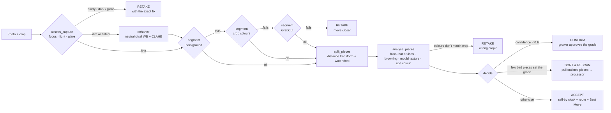

# ChillChain Vision: OpenCV 5 grading agent on AWS

The grower photographs a lot. This service finds every piece of produce, measures colour, bruises,
browning and mould on each one with **OpenCV 5**, grades the lot the way buyers do (by its worst
10%), and decides what the grower should do next. It runs on **AWS Lambda (arm64 / Graviton)**
behind an HTTP API, and keeps every photo, annotated result and decision trace in **S3**.

The ChillChain app calls it first for every photo scan; Gemini Vision is only the fallback when the
service is unreachable. See [docs/OPENCV-AWS.md](../docs/OPENCV-AWS.md) for the full technical report.

## The agent loop



Every arrow above is a decision the agent takes from measured values, and each one is written to
`trace`. The OpenCV result changes what happens next: which tool runs, whether the grower is asked
for a new photo or for approval, and which pieces leave the lot before it is listed.

## API

`POST /grade` with header `x-chillchain-key: <VISION_API_KEY>`

```json
{ "image": "<base64 JPEG or PNG, < 6 MB>", "crop": "strawberry", "scan_ref": "optional id" }
```

Response (shortened):

```json
{
  "ok": true,
  "next_action": { "type": "sort_and_rescan", "remove": 2, "grade_if_sorted": "A", "hint": "…" },
  "result": { "grade": "C", "confidence": 1.0, "ripeness": 4, "uniformity": 88, "pieces": 12,
              "piece_grades": { "A": 10, "B": 0, "C": 2 }, "defect_share": 0.035,
              "defects": ["dark spots or bruises on 2 of 12 pieces", "…"], "reason": "…" },
  "trace": [ { "step": 1, "tool": "assess_capture", "observed": {…}, "decision": "usable; grade as is", "ms": 27.8 }, … ],
  "annotated_jpeg": "<base64>",
  "opencv_version": "5.0.0",
  "s3": { "photo": "photos/…", "annotated": "annotated/…", "trace": "traces/…" }
}
```

`next_action.type` is one of `retake` (with `code`: blur, dark, glare, no_produce, not_crop),
`confirm`, `sort_and_rescan` or `accept` (with `flagged` when spoiled pieces should be pulled out).
`GET /health` returns the OpenCV version.

## Run locally

```bash
cd vision
python3 -m venv .venv && . .venv/bin/activate
pip install -r requirements-dev.txt
python -m pytest -q                    # 14 behaviour tests
VISION_API_KEY=dev-key-at-least-24-chars python serve.py   # http://localhost:8787
```

Point the app at it with `VISION_API_URL=http://localhost:8787` and the same `VISION_API_KEY` in `.env`.

## Deploy to AWS (about 15 minutes)

You need an AWS account, the [AWS CLI](https://docs.aws.amazon.com/cli/latest/userguide/getting-started-install.html)
signed in (`aws configure`), the [AWS SAM CLI](https://docs.aws.amazon.com/serverless-application-model/latest/developerguide/install-sam-cli.html)
and Docker running.

```bash
cd vision
openssl rand -hex 24          # copy this: it is your VISION_API_KEY
sam build                     # builds the arm64 container image with OpenCV 5
sam deploy --guided
```

Answers for `--guided`: stack name `chillchain-vision`, region `ap-south-1` (Mumbai, close to the
growers), `VisionApiKey` = the key from `openssl`, keep the default `RetentionDays`, answer **y** to
"GradeFunction has no authentication" (the function checks the key itself), **y** to creating
managed ECR repositories, and **y** to saving the settings. The output `VisionApiUrl` is the URL
the app needs. Check it:

```bash
curl https://<api-id>.execute-api.ap-south-1.amazonaws.com/health
```

Then connect the app:

1. Neon SQL editor: run `neon/013_opencv_vision.sql`.
2. `bunx wrangler@4 secret put VISION_API_URL --name chillchain` (paste the `VisionApiUrl`), and the same for `VISION_API_KEY`.
3. `bun run deploy`.

On an Intel/AMD laptop, Docker builds the arm64 image under emulation, which is slower but works.
If it fails, change `Architectures: [arm64]` to `[x86_64]` in `template.yaml` and the base image
in `Dockerfile` to `public.ecr.aws/lambda/python:3.12-x86_64`, then build again (the claims about
Graviton in the docs then no longer apply).

## Measure it on real photos

Photograph lots following [ml/README.md](../ml/README.md) (folders `A/ B/ C/ other/`), then:

```bash
python eval/evaluate.py --data photos/strawberry --crop strawberry
python eval/evaluate.py --data photos/strawberry/train --crop strawberry --calibrate   # fits thresholds.json
python eval/evaluate.py --data photos/strawberry --crop strawberry --endpoint <VisionApiUrl> --key <key>
```

It writes `eval-out/report.md` (accuracy, confusion matrix, retake rate, latency) and saves an
annotated copy of every mistake. **The thresholds were set on synthetic test scenes; the only
accuracy numbers to quote are the ones this script prints on your own photos.**

## Files

| Path                          | What it is                                                                                                                            |
| ----------------------------- | ------------------------------------------------------------------------------------------------------------------------------------- |
| `chillvision/tools.py`        | OpenCV 5 tools: capture check, enhancement, 3 segmenters, watershed piece splitting, per-piece defect and colour analysis, annotation |
| `chillvision/agent.py`        | The perception → decision → action loop and its trace                                                                                 |
| `chillvision/profiles.py`     | Colour knowledge per crop (ripe/unripe hues, naturally dark or pale skins)                                                            |
| `chillvision/handler.py`      | Lambda handler: auth, S3 storage, CloudWatch Embedded Metric Format                                                                   |
| `template.yaml`, `Dockerfile` | AWS SAM: arm64 Lambda container, throttled HTTP API, private encrypted S3 with expiry, log retention, CloudWatch dashboard            |
| `eval/evaluate.py`            | Accuracy, latency and threshold calibration on labelled photos                                                                        |
| `tests/`                      | Behaviour tests on synthetic scenes                                                                                                   |
